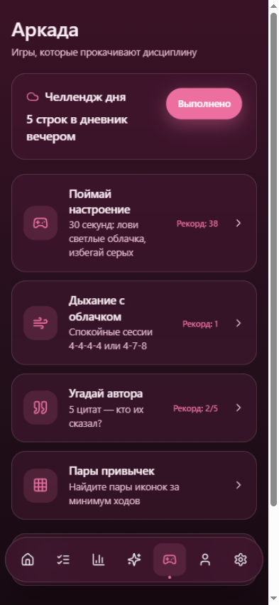
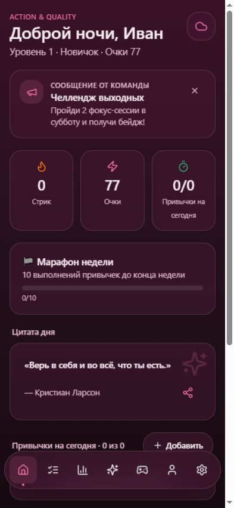
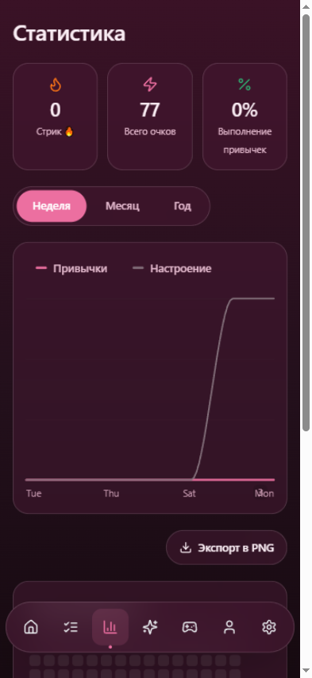

<div align="center">

# ☁️ Action & Quality

**Приложение против лени и за дисциплину.**
Утренний чек-ин настроения с живым облачком → цитата дня → привычки → фокус-сессия.

React · TypeScript · Tailwind · motion · Supabase · Capacitor · Tauri

`npm run build` проходит без ошибок · iOS + Android + Windows + Web · Полностью офлайн

</div>

---

## ✨ Что это

Ежедневный ритуал, который возвращает пользователя каждый день. Прогресс виден в живой статистике и подкреплён геймификацией: XP, уровни с титулами, стрики 🔥 и достижения с конфетти. Дизайн — в духе Apple: **Flushing Pink**, стекло, пружинные анимации, тёмная тема.

| Настроение | Аркада |
|---|---|
|  |  |

Живой блоб **морфится** под настроение (spring-морфинг формы и цвета, не подмена картинки), моргает, дышит и реагирует на касание. Свайп по панели переключает 5 состояний — от «Ужасно» до «Отлично» (в «Отлично» облачко надевает солнцезащитные очки 🕶).

## 🎮 Внутри

<div align="center">

| Главная | Статистика |
|---|---|
|  |  |

</div>

- **Привычки** — расписание по дням недели, напоминания, пружинный чекбокс с частицами
- **Планы** — на день/неделю/месяц, повторяющиеся, подзадачи-чеклисты, импорт календаря `.ics`
- **Аркада** — 4 мини-игры: «Поймай настроение», «Дыхание с облачком», «Угадай автора», «Пары привычек»
- **Статистика** — живой LineChart (Неделя/Месяц/Год с морфингом линий), тепловая карта активности за 15 недель, дневник настроения
- **Геймификация** — XP, уровни с титулами, стрики с множителем ×1.5, марафон недели, 8 достижений
- **Цитаты дня** — детерминированные, меняются в полночь; лента по категориям
- **Фокус** — Pomodoro 25/5 с круглым кольцом прогресса
- **Друзья** — лидерборд по XP (код приглашения)
- **Сообщения команды** — админ отправляет рассылку, пользователи видят баннер на главной вживую
- **Премиум** — неограниченные привычки, годовая статистика, сезонные темы, экспорт в PNG

## 📴 Работает без интернета

Service worker кэширует приложение целиком, все данные зеркалируются в localStorage, а записи в облако встают в очередь и синхронизируются при возврате сети. Есть и версия **всем приложением в одном HTML-файле** — переслал другу, он открыл, работает.

## 🏗 Архитектура

```
React 18 + TypeScript (strict) + Vite
├─ UI: Tailwind CSS, motion/react (spring-анимации), кастомные компоненты в /components/ui
├─ Данные: TanStack Query + персист в localStorage (офлайн-чтения)
├─ Бэкенд: Supabase (Postgres + Auth + RLS) · 6 миграций · атомарный XP через RPC
├─ Офлайн: service worker (precache) + очередь записи (автосинк)
├─ i18n: русский + английский, переключение на лету
└─ Обёртки: Capacitor (iOS/Android) · Tauri v2 (Windows) · PWA
```

## 🚀 Быстрый старт

```bash
npm install
npm run dev      # http://localhost:5173 — работает сразу, без ключей
npm run build    # продакшн-сборка
```

Без бэкенда приложение работает в demo-режиме (данные — в браузере). Подключение бесплатного Supabase-бэкенда, публикация и установка на iPhone/Android/Windows — пошагово в **[docs/ПОДРОБНАЯ-ИНСТРУКЦИЯ.md](docs/ПОДРОБНАЯ-ИНСТРУКЦИЯ.md)**.

Роли в системе: гость (базовый доступ), премиум и администратор (панель управления, рассылки). Ключи доступа выдаются владельцем проекта.

## 📦 Сборки платформ

| Платформа | Способ |
|---|---|
| **Web / PWA** | `npm run build` → любой статический хостинг; устанавливается «На экран Домой» |
| **Один файл** | `npm run build:offline` → самодостаточный HTML, работает с флешки |
| **Android** | `npm run cap:sync` → `gradlew assembleRelease` (подписанный APK) |
| **Windows** | `npm run tauri build` → NSIS-установщик + портативный exe |
| **iOS** | `npm run cap:add:ios` → Xcode (нужен macOS) |

## 🗺 Структура

```
src/pages/       # 15 экранов: настроение, привычки, аркада, статистика, админка…
src/components/  # UI-кит (стекло, spring), блоб, графики, Heatmap
src/lib/backend/ # Один интерфейс — два бэкенда: Supabase + локальный demo
supabase/        # 6 миграций + RLS + RPC
bot/             # Бот выдачи ключей для мессенджера MAX
```

---

<div align="center">

**Против лени. За дисциплину.** ☁️

</div>
